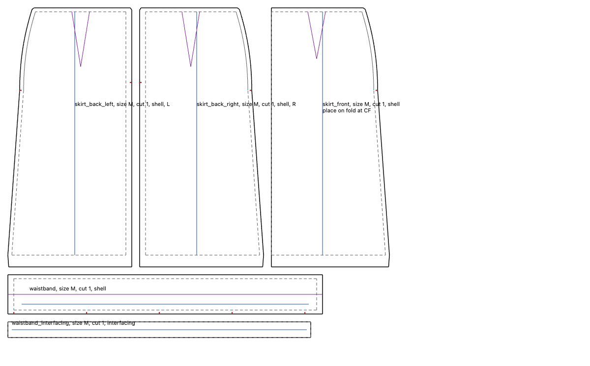

# The dev shell

This is the first way to see a pattern and change it. It draws a drafted pattern, lets you zoom, pan and click on it, and edits measurements through the same command bus the
command line uses. **It is a tool for looking at drafts, not the product.** The product's interface is G5.



That picture is what the renderer drew, read back from the canvas in the check below: the reference skirt's five pieces with cut lines, dashed sew lines, darts, grainlines, notches and labels.

```text
$ bash scripts/dev_shell.sh
dev shell: open http://127.0.0.1:8765/ and press Ctrl-C here to stop
```

**What works today.** Opening a session, drawing its pieces, wheel to zoom about the cursor, drag to pan, click to pick an edge and read its length, editing any measurement, undo and redo, saving and reopening, and exporting canonical text, DXF, and PDF on A0, A3 and A4.

**What does not exist yet.** Drawing or moving a point by hand, because the only edit the bus has today is a measurement change. Saving to anything lasting, because the project lives in the page and closing it loses the project: a browser project in IndexedDB is what [the browser run](browser-capabilities.md) proves and this page does not use yet. A native window. The egui toolkit the roadmap names for this shell, below.

## The same commands

An edit here is a step of [a session](command-line.md), the same grammar a session file uses, handed to the same bus and recorded. So everything done in the page can be saved as a session, and the command-line program can replay it. A real browser check does exactly that, and requires the program to write the exact bytes the page exported. A page with any other way to change a Design could not pass, because the program has only those steps.

Zooming, panning and picking change no Design, so they issue nothing and record nothing.

```rust
use sc_viewer::shell::Shell;

let session = include_str!("../../../conformance/reference-skirt/session.json");
let mut shell = Shell::open(session, (1400, 900)).expect("the skirt drafts");
let before = shell.recording();

// Looking around issues no step.
shell.act(r#"{"do":"zoom","closer":true,"x":300,"y":200}"#);
shell.act(r#"{"do":"pan","x":40,"y":-30}"#);
assert_eq!(shell.recording(), before);

// An edit is a step, and the drawing is redrafted through the bus.
shell.act(r#"{"do":"change","token":"hip_girth","um":1000000}"#);
assert_ne!(shell.recording(), before);

// What was done replays through the command-line path.
let mut disk = sc_store::MemoryRepository::new();
sc_cli::replay(&shell.recording(), &mut disk).expect("the same session");
```

This table is every step a session can take, and how the shell reaches it. A test compares it with the program's own list and with this page, so a new step cannot be forgotten.

| Step | How the shell reaches it |
| --- | --- |
| `evaluate` | On opening and after every edit, for the values panel |
| `preview` | Not offered: an edit here is applied and can be undone |
| `closures` | Not offered yet: the viewer shows a dart's legs and not what closing it does |
| `walk` | Not offered yet: the viewer draws no seams |
| `plant_balance_notch` | Not offered yet: the viewer draws no seams |
| `regenerate` | Not offered yet: the viewer draws one size |
| `grade` | Not offered yet: the viewer draws one size |
| `check_extremes` | Not offered yet: the viewer draws one size |
| `export_graded` | Not offered yet: the viewer draws one size |
| `edit_edge` | Not offered yet: the viewer does not name a piece's edges |
| `references` | Not offered yet: the viewer does not name a piece's edges |
| `repair_reference` | Not offered yet: the viewer does not name a piece's edges |
| `true_seam` | Not offered yet: the viewer draws no seams |
| `change` | A measurement field |
| `undo` | The Undo button |
| `redo` | The Redo button |
| `solve` | Not offered: nothing in the shell states a constraint yet |
| `render` | Not offered: it draws the schematic that predates drafting |
| `draft` | On opening and after every edit |
| `export_pattern` | The export buttons |
| `export` | Not offered: it writes the schematic that predates drafting |
| `save` | The Save button, and after each export |
| `reopen` | The Reopen button |

## A value that cannot be drawn

If an edit gives a value the draft refuses, such as a negative allowance, the shell takes it back through the bus and shows why, so it never holds a Design it cannot show. Those are real steps, `change` then `undo`, and the failed draft changed nothing, so the recording still replays.

Building this found a real defect in the session: after a change, `export_pattern` wrote the drawing from before the change, with the old revision on it (D396). A change, an undo, a redo or a reopen now clears the drawing, and an export without a new draft is refused.

## What draws it

[The canvas verdict](canvas-hosting.md) chose WebGPU in the browser, so the page draws with WebGPU, and a browser without it gets a 2D canvas drawing the same lines. WebGPU has to clear one pixel and read it back before the page uses it, because a machine with no GPU can offer a WebGPU that draws nothing. If it stops later, a fresh 2D canvas takes over and the page says which is drawing. All geometry stays in Rust and in exact arithmetic: [the viewport](viewport.md) computes each line's pixel position and the page only draws what it is given, so precision does not depend on the graphics card and zooming back returns exactly. The page holds no pattern logic. It converts the millimetres in a field to whole micrometres, and that is its only arithmetic on a value.

**The roadmap names egui or iced for this shell, and this is neither.** Fetching egui was refused by this environment's safety check, and I did not work around that. A page needed no new dependency and uses the renderer the verdict chose, so this exists now. `G1-SLICE.14` is closed with it, because the native window is G5's Tauri shell.

## How it is checked

```text
$ cargo test -p sc-viewer --test shell
$ bash docs/tasks/artifacts/dev_shell/run_dev_shell_check.sh
dev shell: 27 checks held in Google Chrome 156.0.8078.80, drawn with WebGPU
```

The first holds the logic on the reference skirt: the coverage table, the recording, refused values, picks at several zooms, and zooming back to exactly the same lines. The second loads the real page in real Chrome and sends real events to the real controls: typing in a field, clicking buttons, turning the wheel, dragging and clicking the drawing. It reads pixels back from what the renderer drew, then replays the page's recording with the native program and compares the five exported files byte for byte.

**What this does not show.** Headless Chrome paints offscreen, so no frame has reached a display in this check, and a person has not yet used it. Hosted Linux first ran it on 2026-11-08 and two checks failed there: the page trusted a WebGPU that drew nothing, and the ink check counted a transparent pixel as ink, so one check had passed on nothing. Both are fixed. Here, with the GPU switched off, WebGPU stops and the 2D canvas draws, and all 27 checks hold. The next hosted run gives Linux's own verdict. Speed on the reference skirt is not measured here, because [the canvas spike](canvas-hosting.md) measured a much larger corpus.

## Names used in this chapter

| Name | Meaning |
| --- | --- |
| `scripts/dev_shell.sh` | Builds and serves the shell on your machine |
| `G1-SLICE.14` | The leaf for the dev shell's toolkit and native window |
| `hip_girth` | An input of the reference skirt |
| `zoom` | A view action, about a pixel |
| `pan` | A view action, by pixels |
| `Shell` | The shell's logic, with no drawing in it |
| `recording` | What the shell has done, as a session |
